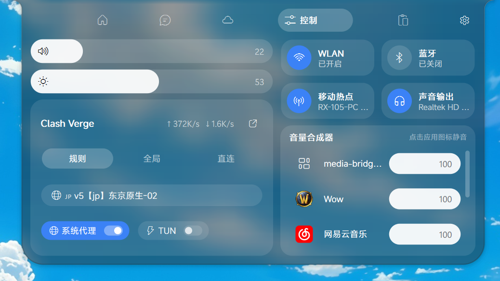

# Wisland · Windows 液态灵动岛

<p align="center">
  <strong>贴在 Windows 屏幕边缘的液态毛玻璃胶囊</strong><br>
  音乐、歌词、消息、系统控制、Clash Verge、实时字幕与快捷工具集中在一处。
</p>

<p align="center">
  
  
  
  
</p>

<p align="center"></p>

> 本仓库基于 [AsamiAkito/wisland](https://github.com/AsamiAkito/wisland) 进行深度二次开发，在保留液态形变、毛玻璃与边缘吸附手感的同时，对交互体验、网易云集成、控制中心、安装启动与性能开销做了全面改造。

## 与原版的区别

| 维度 | 原版 (`AsamiAkito/wisland`) | 本修改版 (`MomoCyann/wisland`) |
| --- | --- | --- |
| **配置与页面管理** | 手工编辑 `config.json` 后重启生效 | 新增图形化 **设置窗口**，支持页面显隐与顺序调节、参数实时生效 |
| **启动与自启** | `pythonw` / 早期 `.vbs` 启动（`uv` 环境易闪控制台） | 新增一键安装 `setup.bat`、带图标原生 `Wisland.exe` 启动器、托盘「退出并重启」及自启无缝迁移 |
| **交互与展开控制** | 悬停展开、图钉常驻，右键统一弹菜单 | 新增悬停/常驻/长关三态与双击空白切长关；可穿透态右键直接退出穿透；托盘点击展开支持移入后再移出自动收起 |
| **收起态与形象** | 程序矢量绘制 `PetFace` 小眼睛表情 | 主页与收起态统一使用自定义图片贴纸（支持随机轮换与鼠标跟随漂移），并修齐时间居中、切页防蓝色光带闪烁 |
| **音乐与网易云集成** | 仅基础 SMTC 会话控制，无本地日志歌名/红心/进度跳转 | 直读 `cloudmusic.elog` 获取曲目/进度/歌词；支持进度条点击拖动跳转、真红心状态识别、**漫游 ↔ 心动**一键后台切换、漫游切歌与本地缩略图防闪、封面 1.5 倍放大 + 仅悬停封面触发多色 Bloom |
| **系统控制与 Clash** | 基础主音量、亮度、WLAN、蓝牙与简易 Clash 控制 | 新增 **分应用音量合成器**、**移动热点**、完整音频设备名称、静音滑块平滑收空；Clash 改为四行布局并通过全局快捷键联动 `verge.yaml` 状态 |
| **天气 / 股票 / 消息** | 股票需本地后端；天气依赖 OpenWeather；消息需手动清角标 | 股票改直连腾讯财经、天气默认免 Key 的 Open-Meteo（开箱即用）；切到 QQ/微信前台自动清未读数；剪贴板改双列卡片；翻译页集成日语实时字幕、查词、单词本与 Anki 同步 |
| **常驻性能开销** | 启动即全量加载重型依赖与高帧率轮询（早期私有内存约 670 MB） | 经两轮深度优化，实现依赖懒加载、COM/绘图缓存、按需降频与线程连接复用（同机实测私有内存降至 **160.5 MB**，线程 **46** 个，静止 CPU 降幅超 70%） |

<details>
<summary>展开查看与原版的详细差异清单</summary>

1. **网易云与播放器深度增强**：
   - 原版因网易云 PC 端默认关闭 SMTC 且不提供进度，基本无法获取完整歌曲与进度；本版直接解码本地 `cloudmusic.elog`（仅预读最近 2MB），并针对漫游模式无 `playOneTrackInPlayingList` 的日志特点结合 `UpdateMenu` / `SMTCWrapper` 标题与 `.dat` 本地封面缓存，避免切歌瞬间闪回「未在播放」与空封面。
   - 新增真红心状态解析：舍弃误代表“心动来源”的 `is_heart` 字段，改为结合切歌窗口与预加载阶段的 `trayLike` 托盘图标事件及 `add_track`/`del_track` 事件同步红心，支持 `Ctrl+Alt+L` 点击即时切换红心。
   - 新增控制栏最右侧 **漫游模式 ↔ 心动模式** 切换按钮（区域剪枝 BFS + 坐标缓存加速，并通过临时 `WS_EX_TOOLWINDOW` 避免网易云在托盘时任务栏闪出图标），以及可点击/拖拽的进度条（支持后台无焦点定位网易云进度条）。
   - 主页播放卡片取消外框容器，专辑封面由 `58px` 放大至 `87px` 并将歌名/歌手移至封面下方；仅鼠标悬停封面区域时触发上浮与封面原色 Bloom 光晕；暂停 5 秒自动切贴纸、恢复播放立即切回歌曲界面，收起态音乐宽度可在 `360–760 px` 调节，设置新增 `media.poll_ms` 刷新间隔调节。
2. **控制中心与工具增强**：
   - 控制页增加分应用独立音量与静音合成器（最多同屏展示 3 项，更多应用内部滚动）；输出设备菜单展示 Windows 完整友好名称；新增移动热点开关。
   - Clash Verge Rev 面板拆分状态/速度、模式、节点、代理与 TUN 四行，优先读取 `verge.yaml` 全局热键操作并回写状态，保持托盘、前端界面与后端一致；移除高频 `netsh wlan` 轮询以消除 Win11 任务栏位置图标闪烁。
   - 股票改用腾讯财经公开接口、天气默认使用 Open-Meteo（补齐当年最低/最高温），免自建后端即可开箱使用；剪贴板改版为双列方形卡片；翻译页整合实时日语字幕（自动按需下载识别模型）、弹窗查词、SQLite 单词本与 Anki 同步。
3. **外观、安装与架构优化**：
   - 切页高度变化时采用边界 1px 夹紧绘制毛玻璃底图并预留弹簧过冲空间，解决桌面顶部亮色壁纸回绕引起的蓝色光带闪烁。
   - 托盘左键点击展开使用独立 `"enter"` 锁，移入岛内再离开可按默认延迟自动收起；新增带托盘同款图标的 `Wisland.exe`、一键配置脚本 `setup.bat`、`run.bat` 及托盘「退出并重启」。
   - 两轮全面性能优化：按需懒加载 `sherpa-onnx`、`fugashi/unidic`、`numpy`（OpenBLAS）与单词本数据库连接；收起静止态降至 ~9 FPS 微弱流光，缓存字体、歌词宽度与贴纸目录，合并后台 WinRT 循环与 HTTP 连接池，控制页关闭时对 Clash / 热点 / 主音量降频轮询并增加通知库 `mtime` 预检。

</details>

## 亮点

- **液态灵动岛**：悬停弹性展开，拖动时拉丝、断开并吸附到最近的屏幕边缘；切页改变高度时自动边界夹紧防背景光带闪烁。
- **三种收起态**：时钟天气、用户贴纸、音乐歌词；滚轮可手动切换。
- **音乐体验**：播放器控制、进度条点击/拖动跳转、网易云红心状态与漫游/心动模式一键切换、漫游切歌无缝过渡、封面悬停多色 Bloom 光晕、固定宽度滚动歌词、暂停 5 秒自动切贴纸，并可在设置中自由调节播放器刷新间隔。
- **自定义贴纸**：主页和收起态共用同一图片目录，文件夹里放什么就随机显示什么。
- **控制中心**：音量、亮度、WLAN、蓝牙、热点、输出设备和分应用音量合成器（支持静音滑块平滑收空与回弹）。
- **Clash Verge Rev**：规则 / 全局 / 直连模式、系统代理、TUN、节点选择和实时速度。
- **消息提醒**：QQ、微信、邮件；切到 QQ / 微信前台后自动清除对应未读数。
- **实时字幕与学习**：系统声音日语识别、翻译、查词、单词本和 Anki 同步。
- **二游活动日历与今日日常**：两周横向时间轴、临期提醒，以及可单独关闭的本地脚本日常摘要。
- **低常驻开销**：实时字幕模型与日语词典按需加载，避免未使用时占用数百 MB 内存。
- **独立可执行入口与原生进程名**：提供带托盘同款图标的 `Wisland.exe` 启动器与托盘「退出并重启」，后台进程直接显示为 `Wisland.exe`。

## 效果图

<p align="center"></p>

<p align="center">
  &nbsp;
  
</p>

<p align="center"></p>

<p align="center">
  
  
  
</p>

> 部分截图来自早期版本；当前贴纸、控制页布局和部分交互以实际运行效果为准。

## 系统要求

- Windows 10 / Windows 11
- Python 3.10 或更新版本
- 推荐使用 64 位 Python
- 建议解压或克隆到当前用户可写目录；配置、日志、模型和运行数据都保存在项目目录中，不建议放进受保护的系统目录。
- 部分能力取决于硬件或第三方软件：
  - 亮度控制需要显示器支持 DDC/CI、WMI 或配置 Twinkle Tray。
  - 蓝牙和移动热点需要系统与驱动支持。
  - Clash 控制针对 Clash Verge Rev / Mihomo。
  - 实时字幕首次使用需要下载约 630–660 MB 的识别模型。

## 安装

### 方法一：下载源码

1. 安装 [Python 3.10+](https://www.python.org/downloads/windows/)，安装时建议勾选 **Add python.exe to PATH**。
2. 下载本仓库并解压，或执行：

```bash
git clone https://github.com/MomoCyann/wisland.git
cd wisland
```

3. 双击 `setup.bat`。
   - 自动创建 `.venv`。
   - 自动补齐 pip 并安装依赖。
   - PyPI 无法连接时会尝试清华镜像。
   - 自动生成用于后台运行的 `.venv\Scripts\Wisland.exe`。
4. 双击 `Wisland.exe`（或 `wisland.vbs`）启动。

首次启动会在项目目录生成：

- `config.json`：用户配置。
- `data/`：日志、缓存和运行数据。

### 启动方式

| 方式 | 用途 |
| --- | --- |
| 双击 `Wisland.exe` | 推荐，独立无控制台 EXE 启动器（与托盘同款图标，开机自启默认调用） |
| 双击 `wisland.vbs` | 兼容静默启动脚本 |
| `run.bat` | 后台启动 |
| `run.bat /r` | 停止旧实例并重新启动 |
| `run.bat /s` | 启动并打开设置 |
| `run.bat /d` | 控制台调试模式 |

开机自启可在 Wisland 设置或系统托盘右键菜单中开启，托盘右键亦提供「退出并重启」。

## 基本操作

| 操作 | 结果 |
| --- | --- |
| 鼠标悬停 | 展开灵动岛 |
| 鼠标离开 | 延迟收起 |
| 收起态滚轮 | 切换时钟、贴纸、音乐视图 |
| 按住拖动 | 脱离当前边缘并吸附到最近边缘 |
| 双击灵动岛 | 在“悬停展开”和“长关”之间切换；可在设置中关闭此行为 |
| 右键灵动岛 | 打开设置窗口 |
| 系统托盘左键 | 展开 / 收起灵动岛；点击展开后若非“常驻展开”模式，鼠标移入灵动岛再离开会自动延迟收起 |
| 系统托盘右键 | 打开主题、展开方式、可穿透、开机自启、退出并重启和退出菜单 |
| 可穿透状态下右键 | 直接退出可穿透状态 |
| 点击专辑封面 | 打开或唤出网易云音乐（仅悬停专辑封面时触发放大与 Bloom 光晕） |
| 点击/拖动进度条 | 跳转音乐播放进度（SMTC 与网易云均支持） |
| 点击漫游/心动按钮 | 播放栏最右侧按钮，在网易云漫游模式与心动模式之间互相切换 |
| 点击主页贴纸 | 随机切换下一张贴纸 |

## 收起态与音乐

### 时钟与天气

- 时间始终以胶囊中心为基准显示。
- 右侧可显示天气与消息角标。
- 可按设置的间隔在时钟与贴纸之间自动轮换。

### 自定义贴纸

默认贴纸目录为：

```text
march7stickers/
```

仓库只保留目录说明，不附带三月七或其他第三方角色贴纸图片；演示与自用所涉三月七贴纸素材来源：[三月七官方高清透明表情包-崩坏：星穹铁道社区-米游社](https://www.miyoushe.com/sr/article/60702394)（请自行获取并放入目录中）。

支持：

```text
.png  .jpg  .jpeg  .webp  .gif  .bmp
```

GIF 当前按静态帧显示。可在 **设置 → 外观 → 动效 → 贴纸图片文件夹** 中选择任意目录。主页和收起态共用该目录；添加或删除图片后会在后续随机切换时自动重新扫描。

### 音乐与歌词

支持两类媒体来源：

- **网易云音乐**：读取本地 `cloudmusic.elog`，无需安装插件，可获得歌曲、歌手、进度、播放状态和红心状态。
- **SMTC 播放器**：QQ 音乐、Spotify、浏览器、B 站等，需要播放器接入 Windows 系统媒体控制。

行为说明：

- 开始播放时自动切换到音乐视图。
- 暂停后保留歌曲界面 5 秒，随后切换为贴纸。
- 恢复播放后立即切回歌曲界面。
- 可穿透状态下也遵循同样逻辑。
- 收起态音乐宽度可在 `360–760 px` 之间调整。
- 歌名或歌词超出设定宽度时，会在胶囊内部横向滚动，不再无限拉长灵动岛。
- 网易云红心按钮会读取真实喜欢状态（含漫游切心动时的预加载状态），并支持添加 / 取消喜欢；漫游切歌时结合本地缓存缩略图与状态兜底，避免短暂闪出“未在播放”或空封面。
- 支持点击或拖动进度条跳进度，以及右侧按钮一键在网易云漫游模式与心动模式间切换（通过区域剪枝与坐标缓存后台无感触发，托盘隐藏时不抢焦点也不闪现任务栏图标）。
- 设置中可调 `media.poll_ms`（`100–3000 ms`）控制播放器同步刷新频率，修改后实时生效。

## 页面功能

### 主页

- 专辑封面（仅悬停封面区域时放大并扩散封面原色 Bloom 光晕）、歌名、歌手、可点击/拖动进度条与播放控制。
- 网易云红心状态与漫游/心动模式切换按钮。
- 自定义贴纸与鼠标跟随效果。
- 展开方式、可穿透、静音、截图可见性、全屏显示等快捷开关。
- 自定义快速启动应用，支持新增、编辑、删除和总开关。

### 消息

- QQ、微信、Thunderbird / 邮件提醒。
- 数据来源包括 Windows 通知数据库和任务栏闪烁事件。
- 不读取或上传聊天正文。
- 手动切换到 QQ / 微信前台后，自动清除对应的 Wisland 未读数量；这不等同于向聊天服务器发送已读回执。
- 消息历史只保留当前运行期间最近 50 条，不做跨启动持久化。
- 没有消息历史时自动缩短页面，不保留大块空白。

### 股票

- A 股、港股、美股行情与分时。
- 搜索添加、右键删除自选。
- 支持涨跌幅、目标价和提醒。

### 天气

- 默认使用 Open-Meteo，无需 API Key。
- 可选 OpenWeather。
- 支持多城市、逐小时和多日预报。

### 活动日历

- 数据来自 [StarRailAssistant 公共 API](https://starrailassistant.top/reference/public-api/#获取活动数据)，无需 API Key。可选游戏和区服以该接口支持的列表为准，在 **设置 → 活动日历** 中开关和调序。
- 日历按北京时间展示 14 天。每条活动有独立配色，悬停可查看起止时间，点击游戏名可折叠该组。未来 72 小时内有活动结束时，「今天」旁显示数量，悬停可看截止时间。顶部的日历页图标也会出现小钟，在其他页面同样能看到。
- **今日日常**在日历上方显示实训或活跃度、刷本项目、完成时刻和脚本耗时。**设置 → 活动日历 → 显示今日日常**可隐藏该区并停止日志读取。

#### 今日日常的日志来源

活动数据和日常结果来自两套来源。原神等游戏可以显示活动日历，目前日常摘要只实现了以下三套脚本的日志解析。

| 游戏 / 工具 | 已支持的日志格式 |
| --- | --- |
| 崩坏：星穹铁道 / 三月七助手 | `March7thAssistant_full/logs/runs` 下的单次运行 `.log` 和 `.json`，读取每日实训分数、已完成的副本和运行结果 |
| 绝区零 / 一条龙 | `ZZZonedragon/.log/log.txt` 及其轮转日志，读取活跃度奖励、已结算的刷本和电量变化 |
| 鸣潮 / OK-WW | `ok-ww/data/apps/ok-ww/working/logs/ok-script.log` 及其轮转日志，读取日常奖励流程和有日志证据的体力结算 |
| 千机链（可选） | `千机链/.log/script_chainer_runner.log` 及其轮转日志，补充各脚本的启动、退出和耗时记录 |

在 **设置 → 活动日历 → 今日日常日志** 中，可以选择一个脚本总目录，或分别为千机链、三月七助手、一条龙、OK-WW 指定安装目录或日志目录。单独指定的路径优先。总目录留空时，Wisland 尝试固定磁盘根目录下名为 `mihoyoMOD` 的目录，按上表的已知结构查找，不递归扫描磁盘。设置中显示日志文件是否找到，悬停可查看探测路径。

日常按北京时间 04:00 换日。打开活动日历立即读取，页面可见时每 30 秒检查一次，也可手动刷新。自动跑和手动跑都根据当天写入的日志显示结果。日志缺失、实际得分未知或脚本异常退出会按已有证据显示。本地日志仅用于生成摘要。日常功能不运行脚本，也不上传日志。

#### 扩展其他脚本

原神日常、其他游戏日常，以及同一款游戏的其他脚本格式，**当前均不支持**。设对目录也不会自动推断陌生日志的含义。要扩展时，可以让 AI 或开发者参考 `wisland/services/game_daily.py`，用脱敏日志样例增加来源定位和解析规则，再把实际结果映射到 `Daily` / `Run` 并添加展示项。建议用完成、失败、取消、跨午夜和重复运行的样例验证，区分脚本退出与日常达标。

### 控制中心

- 主音量与静音。
- 显示器亮度。
- WLAN、蓝牙、移动热点。
- 完整音频输出设备名称与快速切换。
- 分应用音量合成器：最多同时显示 3 项，更多应用在卡片内滚动。
- 控制项可在设置中单独显示或隐藏。

### Clash Verge Rev

检测到 Clash Verge Rev 后，控制页会显示：

- 规则 / 全局 / 直连模式。
- 系统代理。
- TUN 模式。
- 当前节点与节点切换。
- 上传 / 下载速度。
- 打开或唤出 Clash Verge。

模式、系统代理和 TUN 优先读取并触发 Clash Verge 自己在 `verge.yaml` 中配置的全局快捷键，让 Clash 前端、托盘和后端状态保持同步；节点选择使用 Mihomo 控制接口。

默认配置目录：

```text
%APPDATA%\io.github.clash-verge-rev.clash-verge-rev
```

如果安装位置或配置目录不同，可在 Wisland 设置中修改。

### 剪贴板与翻译

- 最近文字 / 图片剪贴板历史。
- 点击条目重新复制。
- 全局热键打开剪贴板页或翻译当前剪贴板文本。
- 翻译服务支持自定义 OpenAI 兼容接口，默认配置为 DeepSeek。

### 实时字幕、查词与 Anki

流程：

```text
系统声音 → VAD 断句 → 日语识别 → 中文翻译 → 字幕历史 / 查词 / 单词本
```

- 第一次点击“开始聆听”会下载识别模型。
- 未配置翻译 API Key 时仍可显示日语识别结果。
- 支持点击单词查词、加入单词本、导出和同步到 AnkiConnect。
- 实时字幕依赖与日语词典均为按需加载，平时不会提前占用大量内存。

## 设置与配置

大部分功能可直接在设置窗口修改。完整配置保存在项目根目录的 `config.json`，首次启动自动生成。

常用配置：

| 配置 | 说明 |
| --- | --- |
| `island.edge` | 吸附边缘：`top` / `bottom` / `left` / `right` |
| `island.expand_mode` | `hover` 悬停展开、`always` 常驻展开、`never` 长关 |
| `island.compact_view` | 默认收起态：`clock` / `pet` / `music` |
| `island.compact_media_width` | 收起态音乐宽度，默认 `640` |
| `island.sticker_dir` | 主页和收起态共用的贴纸目录 |
| `island.double_click_long_off` | 是否允许双击切换长关 |
| `island.passthrough` | 是否启用鼠标穿透 |
| `media.auto_show` | 播放时是否自动显示音乐视图 |
| `media.lyrics` | 是否获取并显示歌词 |
| `media.poll_ms` | 播放器刷新间隔（毫秒，`100–3000`，默认 `700`） |
| `controls.show_mixer` | 是否显示分应用音量合成器 |
| `clash.config_dir` | Clash Verge 配置目录 |
| `game_calendar.games` | 活动日历中开启的游戏/区服及显示顺序 |
| `game_daily.enabled` | 显示今日日常和启用日志读取 |
| `game_daily.root` / `game_daily.folders` | 脚本总目录和各来源的覆盖目录。留空时使用已知路径规则 |
| `translate.api_key` | 翻译 API Key |
| `hotkeys.*` | 全局快捷键 |

修改 `config.json` 前建议先退出 Wisland，或通过设置界面修改，避免运行中的配置保存覆盖手工编辑。

## 全局快捷键

默认快捷键：

| 功能 | 默认值 |
| --- | --- |
| 展开 / 收起 | `Ctrl+Alt+I` |
| 翻译剪贴板 | `Ctrl+Alt+J` |
| 剪贴板历史 | `Ctrl+Alt+V` |

快捷键被其他软件占用时，可在设置中修改并立即重新注册。

## 性能说明与优化历史

本仓库在常驻内存、CPU、线程数与磁盘 I/O 方面历经两轮系统性性能优化：

### 第一轮性能优化：重型依赖按需加载与 COM 节流（首次全面整改）
- **实时字幕依赖按需加载**：`sherpa-onnx` 等语音识别依赖与模型改为仅在用户点击“开始聆听”时加载，平时不驻留内存。
- **日语词典按需加载**：`fugashi` / `unidic`（词典映射本身约 247 MB）改为第一次分词或查词时才加载。
- **贴纸与页面资源治理**：自定义贴纸缓存增加数量上限（主页与收起态分别限额缓存），防止大图目录无限增长；隐藏未启用的页面（如关闭股票页）自动停止后台轮询；采用独立无窗口 `Wisland.exe` 避免额外转启动控制台进程。
- **COM 与系统轮询节流**：音频峰值查询 `peak()` 增加 150ms 短时缓存，避免每个绘制帧跨 COM 调用；控制页展开时延迟 350ms 枚举应用音频会话并复用缓存的 `IAudioSessionManager2`（单次枚举由约 90ms 降至约 0.1ms），避免阻塞展开动画；QQ / 微信前台已读检测间隔调优为 1 秒。

### 第二轮性能优化：全项目 CPU / 内存 / 线程 / I/O 深度审查与优化
- **修复 `numpy` / OpenBLAS 隐式启动泄露**：移除 `learn/wordbook.py` 顶层的 `import numpy as np`（改为 `save_wav()` 内按需导入），并延迟 `LearnService` 的 `wordbook.db` 连接与同步定时器初始化，彻底消除未开启字幕时仍常驻加载 `libscipy_openblas64.dll` 及其约 20 个工作线程的问题。
- **收起静止态自适应帧率**：收起且弹簧静止时，时钟、暂停音乐与远离光标的贴纸视图自动降至约 `9 FPS`（`110ms`）维持边缘微弱流光；鼠标靠近贴纸、播放滚动歌词或展开/拖拽时即时切回 `45–60 FPS`。
- **绘制热路径缓存**：`ui_font()` / `icon_font()` 增加 `@lru_cache` 并过滤本机未安装字体族；`CompactView` 缓存歌词行像素宽度并移除无效渐变构造；`sticker_paths()` 按目录 `st_mtime_ns` 缓存并修复空目录每帧扫盘；`Island._inside()` 增加包围盒快速粗筛。
- **后台服务按需降频与连接/线程复用**：控制中心未展开时 `ClashService` 跳过 `/connections` 大列表拉取并放宽至 `3s`、`HotspotService` 放宽至 `20s`、`AudioService` 主音量轮询放宽至 `500ms`；`RadioService` 与 `HotspotService` 合并共用单一 `winrt_loop()` 后台线程；抽取公共 `http_client()` 复用连接池；`NotifyService` 先校验 `wpndatabase.db` / `-wal` 的 `mtime` 再查询 SQLite，无未读计数时跳过前台进程查询。
- **内存峰值与缓存上限治理**：`netease.py` 启动日志预读 `PRELOAD_BYTES` 从 `32 MB` 下调至 `2 MB`（消除启动瞬间约 96MB 的解码堆峰值）；为封面、歌曲元数据、应用图标缓存补齐淘汰上限；剪贴板图片改为打开页面时按需解码缩略图并缓存缩放后 `QPixmap`，主页收起时自动释放多余大图贴纸缓存。

> **开发机同机实测参考**：第一轮按需加载后常驻内存由早期约 `670 MB` 显著回落；第二轮深度优化后，同一运行环境下进程私有提交内存（Private / VMS）由 **`691.3 MB` 进一步降至 `160.5 MB`（-76.8%）**，常驻线程数由 **`59` 降至 `46`**，收起态 3 秒采样总体 CPU 由 **`19.3%` 单核降至 `5.21%` 单核（用户态 CPU -91%）**，周期性读 I/O 减少 **95%**（实际数值随字体、页面、实时字幕、词典、播放器和驱动而异）。

## 网络与隐私

| 功能 | 可能访问的资源 |
| --- | --- |
| 天气 | Open-Meteo 或用户配置的 OpenWeather |
| 股票 | 腾讯财经公开接口 |
| 活动日历 | StarRailAssistant 公共活动 API |
| 今日日常 | 仅读取所配置的本地脚本日志 |
| 歌词 | 网易云公开歌词接口 |
| 翻译 | 用户配置的翻译 API |
| 实时字幕模型 | Hugging Face / hf-mirror |
| Clash | 本机 Mihomo HTTP 或命名管道控制接口 |

- 网易云播放信息来自本机日志。
- QQ / 微信提醒来自 Windows 通知和窗口闪烁事件。
- Wisland 不会主动上传聊天记录、剪贴板历史或本地贴纸。

## 常见问题

### 双击 `wisland.vbs` 没反应，或提示缺少 PySide6

运行 `setup.bat`。不要只在全局 Python 中执行 `pip install`。仍然失败时，可删除 `.venv` 后重新运行安装。

日志位置：

```text
data\wisland.log
```

### 任务管理器仍显示 Python

重新运行一次 `setup.bat`，确认存在：

```text
.venv\Scripts\Wisland.exe
```

之后使用 `wisland.vbs` 或 `run.bat` 启动，不要直接运行 `pythonw.exe run.pyw`。

### 没有显示正在播放

- 网易云音乐默认通过本地日志读取。
- QQ 音乐需要在设置中启用 SMTC / 系统媒体控制。
- 浏览器媒体是否可用取决于浏览器和网页是否注册系统媒体会话。

### 没有歌词

- 确认 `media.lyrics` 为 `true`。
- 部分歌曲没有可用歌词或翻译。
- 网络不可用时不会获取在线歌词。

### Clash 按钮没有反应

- 确认 Clash Verge Rev 已开启全局快捷键。
- 检查 `clash.config_dir` 是否指向正确的配置目录。
- 节点切换还需要 Mihomo 控制器和 secret 可被读取。

### 亮度调节无效

部分外接显示器需要在显示器菜单中开启 DDC/CI；不支持时可在设置中指定 Twinkle Tray。

### 实时字幕第一次启动较慢

模型和重型依赖采用按需加载。第一次使用需要下载模型并初始化识别器，之后会更快。

## 项目结构

```text
wisland/
├─ Wisland.exe              # 独立桌面启动器（无控制台窗口）
├─ wisland.ico              # 应用与托盘图标
├─ run.pyw                  # 程序入口
├─ wisland.vbs              # 兼容启动脚本
├─ run.bat                  # 启动 / 重启 / 调试
├─ setup.bat                # 一键安装
├─ config.example.json      # 配置示例
├─ march7stickers/          # 默认贴纸目录
├─ screenshots/             # 当前版本截图
├─ docs/                    # 其他 README 图片
├─ scripts/                 # 模型与辅助脚本
├─ tests/                   # 单元测试
└─ wisland/
   ├─ app.py
   ├─ core/                 # 配置、重启辅助与后台任务
   ├─ services/             # 音频、媒体、消息、天气、Clash 等
   ├─ live/                 # 实时字幕流水线
   ├─ learn/                # 查词、单词本、Anki
   └─ ui/                   # 灵动岛、页面、设置和组件
```

## 开发

```bash
git clone https://github.com/MomoCyann/wisland.git
cd wisland
setup.bat
run.bat /d
```

提交前建议至少运行：

```bash
.venv\Scripts\python.exe -m compileall wisland
.venv\Scripts\python.exe -X utf8 -m unittest tests.test_netease_liked tests.test_netease_fm_and_mode -v
```

本项目目前以 Windows API、Core Audio、WinRT 和 PySide6 为核心，不支持 Linux / macOS。

## 致谢

- 原项目：[AsamiAkito/wisland](https://github.com/AsamiAkito/wisland)
- 实时字幕与单词本流水线移植自：[YishengTranslator-White](https://github.com/kayson-39/YishengTranslator-White)
- Clash Verge Rev：[clash-verge-rev/clash-verge-rev](https://github.com/clash-verge-rev/clash-verge-rev)
- 活动数据由 [StarRailAssistant 公共 API](https://starrailassistant.top/reference/public-api/) 提供。

## License 与素材说明

程序代码采用 [MIT License](LICENSE)。

仓库不附带三月七或其他第三方角色贴纸图片；效果图中使用的三月七贴纸来源为 [三月七官方高清透明表情包-崩坏：星穹铁道社区-米游社](https://www.miyoushe.com/sr/article/60702394)。用户自行添加的图片不因程序代码采用 MIT License 而自动获得 MIT 授权，请确保素材拥有合法使用与分发许可。
